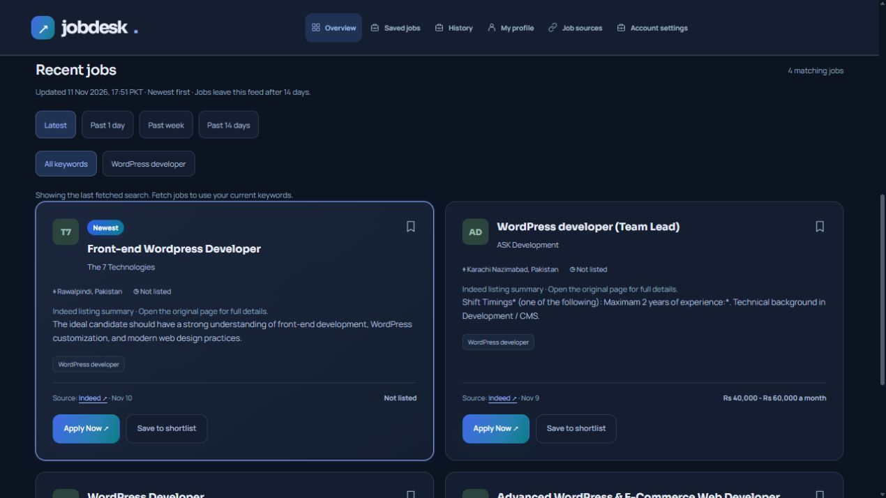

# Jobdesk

A private job-search dashboard for managing a CV, search keywords and saved opportunities, with links to original application pages.



Screenshot of the local dashboard on 11 November 2026. It shows previously collected listings, not a guarantee of current job-board availability.

## Run locally

Requires Node.js 24 or newer.

```sh
npm ci
npm start
```

Open http://localhost:4180 and create an account. On Windows, `START-JOBDESK.cmd` starts the local app and `STOP-JOBDESK.cmd` stops it.

Personal data and local configuration are created under `data/` and are excluded from Git. Existing local accounts, CVs, provider keys and saved jobs are not included in this repository. A fresh installation starts with no personal account data.

## Features and current limits

- Email/password sign-in, optional Google sign-in configuration and account recovery.
- CV upload and editable skills, experience and profile details.
- Up to seven saved search keywords, job-source connections and saved-job history.
- Original application links; the user reviews and submits applications on the source website.
- Recent-job filters and duplicate handling. The live feed excludes verified postings older than 14 days.
- Optional JSearch, SearchApi and API.SH connections, configured inside Account settings. Provider plans and coverage apply.
- Optional Playwright browser worker and scheduled collection. Install Chromium using `INSTALL-BROWSER.cmd` or the hosting instructions. Job-board verification, sign-in and access restrictions can stop collection; automatic Indeed/LinkedIn collection is not guaranteed.

The email-alert IMAP importer is a proposed design in `docs/superpowers/specs/2026-11-11-email-alert-import-design.md`; it is not implemented. The Indeed Publisher Plugin is not connected.

## Checks

```sh
npm test
npm run check:hosting
```

Tests use isolated fixtures and temporary data. They do not prove current live job-board availability.

## Hosting and scheduling

Before internet-facing use, follow the [production setup checklist](docs/PRODUCTION.md). This is a personal dashboard, not an unrestricted public registration service. Hosting and live provider access require separate verification.

See [hosting instructions](HOSTING-SETUP.md) and [hosting compatibility notes](HOSTINGER-CHECK.md). The app needs persistent writable storage for SQLite and private configuration. A Chromium worker needs compatible browser dependencies; ordinary shared hosting may not support it.

Use `.env.hosting.example` as a configuration reference. Set secrets privately on the destination server, and configure HTTPS, Google redirect URIs and provider keys for that installation. Do not commit populated environment files, databases, CVs or browser profiles.

```sh
npm run cron
```

Runs the configured collection schedule once. An external scheduler must invoke it for repeated runs. Running the web app alone is not a hosted cron service.
